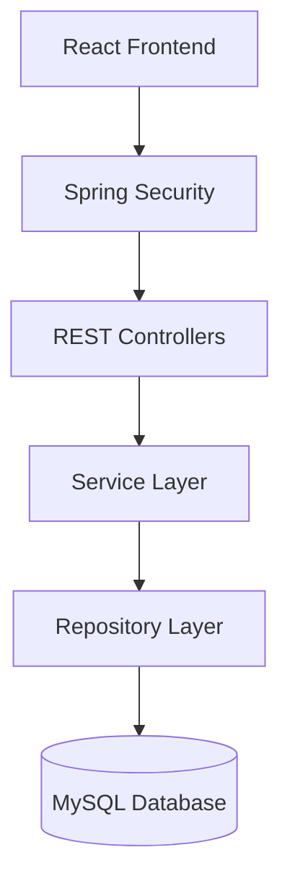

# Kalpanaaa Finance – Digital Finance Management Platform


## Overview

Kalpanaaa Finance is a full-stack demo application developed to demonstrate digital financial management workflows, including wallet management, investment planning, loan tracking, and financial advisory services.

The platform provides separate interfaces for Customers, Financial Consultants, and Administrators.

> **Note:** This is a demonstration project. It does not process real financial transactions or provide actual financial services.

## Features

- **Customer Portal:** Wallet management, transactions, investment plans, and loan tracking.
- **Consultant Portal:** Client consultations, meeting schedules, and advisory reports.
- **Admin Portal:** User management, dashboard analytics, and content management.
- **Public Portal:** Financial information, EMI calculator, and investment calculator.

## Tech Stack

| Category | Technologies |
|---|---|
| Frontend | React.js, Vite, Tailwind CSS |
| Backend | Java 21, Spring Boot |
| Security | Spring Security, JWT |
| Database | MySQL, Spring Data JPA |
| Migration | Flyway |
| Build Tool | Maven |

## Architecture

The application follows a modular monolithic architecture with separate frontend, backend, and database layers.



## Getting Started

**Prerequisites:** JDK 21, Node.js, npm, MySQL 8.0, and Git.

**1. Clone the repository**

```bash
git clone <YOUR_REPOSITORY_URL>
cd kalpanaa-finance
```

**2. Create the database**

```sql
CREATE DATABASE kalpanaaa_finance;
```

**3. Configure MySQL credentials** in `application.properties`.

**4. Run the backend**

```bash
cd backend-java
./mvnw spring-boot:run
```

**5. Run the frontend**

```bash
cd frontend
npm install
npm run dev
```

**Application URLs:**
- Frontend: `http://localhost:5173`
- Backend: `http://localhost:8080`

## License

This project is licensed under the MIT License.
